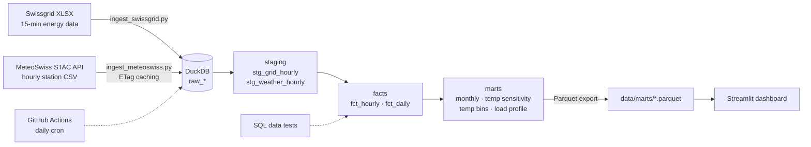

# ⚡ Swiss Electricity Demand × Weather

An end-to-end data engineering project that answers a simple question with public Swiss data:

> **How much does Swiss electricity demand rise when it gets colder?**

It ingests 15-minute grid data from **Swissgrid** and hourly station data from **MeteoSwiss**, models them in **DuckDB** with layered SQL (staging → facts → marts), runs data-quality tests, refreshes daily with **GitHub Actions**, and serves a **Streamlit** dashboard.

## Architecture



## What it shows

* **Temperature sensitivity** per heating season: extra MWh/day of demand for each °C colder (linear fit on working days < 15 °C).
* **Consumption vs temperature** scatter by day type (working day, Saturday, Sunday, public holiday).
* **Typical load profiles** (MW by hour) for winter vs summer half-year.
* **Monthly balance** of production vs consumption, heating degree days (SIA 381/3, 20/12) and year-over-year change.

## Data engineering highlights

| Topic | Implementation |
|---|---|
| Incremental, idempotent loads | SHA-256 file hashes in `ingest_log`; reloading a file replaces its rows; staging deduplicates on the latest load |
| Efficient downloads | HTTP `If-None-Match` / ETag caching against the STAC API |
| Time zones & DST | Swissgrid local timestamps converted to UTC with DST inference; all joins in UTC, calendar features in Europe/Zurich |
| Interval semantics | 15-min "interval end" timestamps rolled up to hourly buckets correctly |
| Layered SQL models | `sql/models/01..08` run in order (dbt-style, no extra tooling) |
| Data quality | `sql/tests/assert_*.sql` fail the pipeline, `warn_*.sql` only log |
| Feature engineering | Swiss public holidays (computed Easter), day type, season, heating degree days |
| Orchestration | GitHub Actions daily cron + manual trigger; marts committed as Parquet |
| Unit tests | `pytest` on parsers, DST handling, asset selection, holiday calendar |

## Quick start

```bash
git clone <this repo> && cd swiss-energy-weather
python -m venv .venv && source .venv/bin/activate   # Windows: .venv\Scripts\activate
pip install -r requirements.txt

# 1. Download Swissgrid "Energy Statistic Switzerland" XLSX files (2019 → current year) from
#    https://www.swissgrid.ch/en/home/customers/topics/energy-data-ch.html
#    and save them in data/raw/swissgrid/

# 2. Run tests and the pipeline
pytest -q
python -m src.pipeline all

# 3. Open the dashboard
streamlit run dashboard/app.py
```

Individual steps: `python -m src.pipeline swissgrid | meteo | transform`.

## Data model

| Table | Grain | Description |
|---|---|---|
| `raw_swissgrid` | quarter-hour × series | Long format, UTC, kWh |
| `raw_meteo_hourly` | station × hour | Temperature, radiation, precipitation, sunshine, humidity |
| `stg_grid_hourly` | hour (UTC) | End-user consumption, total consumption, production (MWh) |
| `stg_weather_hourly` | hour (UTC) | Weighted national weather from 6 stations |
| `fct_hourly` | hour | Energy + weather + calendar features |
| `fct_daily` | local day | Daily totals, temperature stats, HDD, completeness flag |
| `mart_monthly` | month | Totals, balance, YoY change |
| `mart_temp_sensitivity` | heating season | Regression slope, intercept, R² |
| `mart_temp_bins` | 1 °C bin × day type | Mean and P10/P90 daily consumption |
| `mart_load_profile` | season × day type × hour | Average load (MW) |

## Assumptions & limitations

* Swissgrid timestamps are treated as Swiss local time marking the **end** of each 15-minute interval. The `warn_incomplete_days` test reports days that do not have 92/96/100 quarter-hours.
* MeteoSwiss timestamps are UTC (interval end for hourly data), per the official documentation.
* The national temperature is a weighted average of 6 lowland stations (Zürich, Bern, Basel, Genève, Pully, Lugano). Weights in `src/config.py` are approximate.
* Swissgrid data for recent months is provisional and may be revised.

## Roadmap

- [ ] Add ElCom electricity tariffs per municipality (LINDAS SPARQL endpoint)
- [ ] Add BFE register of electricity production plants (solar growth by canton)
- [ ] Day-ahead demand forecast model with weather features
- [ ] Migrate SQL models to dbt-duckdb

## Data sources & licences

* **Swissgrid** — Energy Statistic Switzerland (15-minute aggregates). Source: Swissgrid AG.
* **MeteoSwiss** — Automatic weather stations (SwissMetNet), Open Government Data. Source: MeteoSwiss.

---
Author: Diogo Rocha · Electrical engineer moving into data engineering
